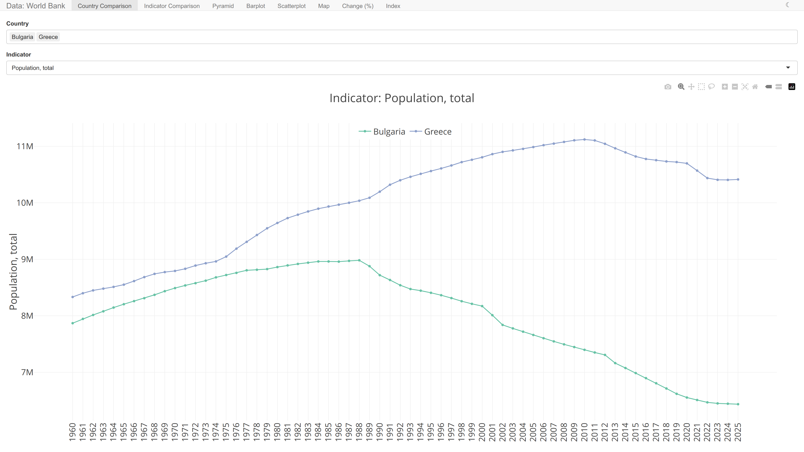

# WDI Worldbank Visualizations

**[Open the live app](https://sedzinfo.shinyapps.io/golemworldbank/)** ·
[Website](https://sedzinfo.github.io/golemworldbank/)

A Shiny application, built as a
[golem](https://thinkr-open.github.io/golem/) package, for exploring
World Bank development indicators through interactive country
comparison, indicator comparison, population pyramid, ranked bar chart,
correlation scatter, and choropleth map views.

## Installation

### Prerequisites

1.  **Install R**: <https://cran.r-project.org/>
2.  **Install RStudio** (optional but recommended):
    <https://posit.co/downloads/>

### Package Installation

Open RStudio (or an R console) and run:

[`install.packages`](https://rdrr.io/r/utils/install.packages.html)`(`` `` ``"golemworldbank"``,`` `` repos ``=`` `[`c`](https://rdrr.io/r/base/c.html)`(``"https://sedzinfo.r-universe.dev"``, ``"https://cloud.r-project.org"``)`` ``)`

[R-universe](https://sedzinfo.r-universe.dev/golemworldbank) builds
golemworldbank from this repository, and CRAN provides the packages it
needs.

To install from GitHub instead:

`# Install devtools if you haven't already`` `[`install.packages`](https://rdrr.io/r/utils/install.packages.html)`(``"devtools"``)`` ``# Install golemworldbank from GitHub`` ``devtools``::`[`install_github`](https://devtools.r-lib.org/reference/install-deprecated.html)`(``"sedzinfo/golemworldbank"``)`

Or install the source tarball of the [latest
release](https://github.com/sedzinfo/golemworldbank/releases/tag/latest),
which is rebuilt from `main` on every change, together with the PDF
manual:

[`install.packages`](https://rdrr.io/r/utils/install.packages.html)`(`` `` ``"https://github.com/sedzinfo/golemworldbank/releases/download/latest/golemworldbank_0.0.1.tar.gz"``,`` `` repos ``=`` ``NULL``, type ``=`` ``"source"`` ``)`

## Alternative installation

Clone the repository and install locally:

    git clone https://github.com/sedzinfo/golemworldbank.git

Then in R:

    devtools::install_local("golemworldbank")

The package data are normal files in the repository. Only the raw World
Bank downloads that `financial_indicators.R` reads (in `data/` and
`data-raw/`) are stored with Git LFS: you need them, and Git LFS (see
Git LFS Setup below), only to regenerate the data.

## Usage

    library(golemworldbank)
    run_app()

## Update data

In order to update the data: 1. run the financial_indicators.R script 2.
run the generate_package.R script

The data updates almost yearly so there is no need for frequent updates

## Features

Each feature below is a Shiny module rendered as its own tab in the app:

- 📊 **Country Comparison**: plot one indicator’s value over time as one
  line per selected country
- 📈 **Indicator Comparison**: plot several indicators’ values over time
  for a single country
- 👥 **Pyramid**: animated population pyramid by age group and sex, for
  a selected country, over time
- 📉 **Barplot**: animated ranked bar chart of one indicator per
  country, ranked by value in the most recent year
- 🔍 **Scatterplot**: animated bubble scatter correlating two
  indicators, bubble size by population, colored by region
- 🗺️ **Choropleth**: animated choropleth map of one indicator by
  country, over time
- 📋 **Index**: searchable table listing every indicator name available
  in the data
- ℹ️ **About**: what the app shows, the source and license of the data,
  and the acknowledgments

## Data

The package ships four lazy-loaded datasets, sourced from [World Bank
Open Data](https://data.worldbank.org):

- `mfi` — long-format indicator values, one row per
  country/indicator/year (`Country Code`, `Country Name`,
  `Indicator Name`, `Year`, `value`), with the names of the countries
  and indicators stored as codes to keep the file small;
  [`mfi_table()`](https://sedzinfo.github.io/golemworldbank/reference/mfi_table.md)
  gives it with the names as text, as the app uses it.
- `mfi_population` — long-format population counts by five-year age
  group and sex, used by the Pyramid tab.
- `country_code` — country/region reference metadata (region, income
  group, and other World Bank classifications), used to join region info
  in the Scatterplot tab.
- `indicator_info` — the World Bank topic and definition of every
  indicator in `mfi`, shown in the Index tab.

Full column-level documentation is available via
[`?mfi`](https://sedzinfo.github.io/golemworldbank/reference/mfi.md),
[`?mfi_table`](https://sedzinfo.github.io/golemworldbank/reference/mfi_table.md),
[`?mfi_population`](https://sedzinfo.github.io/golemworldbank/reference/mfi_population.md),
[`?country_code`](https://sedzinfo.github.io/golemworldbank/reference/country_code.md),
and
[`?indicator_info`](https://sedzinfo.github.io/golemworldbank/reference/indicator_info.md).

------------------------------------------------------------------------

## Git LFS Setup

The raw World Bank downloads (the large files in `data/` and `data-raw/`
that `financial_indicators.R` reads) are stored using [Git
LFS](https://git-lfs.com). You need them only to regenerate the data.
Follow the steps below to clone the repository and retrieve them.

### 1. Install Git LFS (one-time setup)

**Ubuntu/Debian:**

``` bash
sudo apt install git-lfs
git lfs install
```

**Mac:**

``` bash
brew install git-lfs
git lfs install
```

**Windows:**

Download and run the installer from <https://git-lfs.com>, then:

``` bash
git lfs install
```

### 2. Clone the repository

``` bash
git clone https://github.com/sedzinfo/golemworldbank.git
cd golemworldbank
```

### 3. Pull the LFS files

``` bash
git lfs pull
```

> **Note:** If you cloned the repository *before* installing Git LFS and
> large files appear as small pointer files, run:
>
> ``` bash
> git lfs install
> git lfs pull
> ```

To verify that LFS files downloaded correctly:

``` bash
git lfs ls-files
```

## Screenshots



------------------------------------------------------------------------

[](https://sedzinfo.r-universe.dev/golemworldbank)

